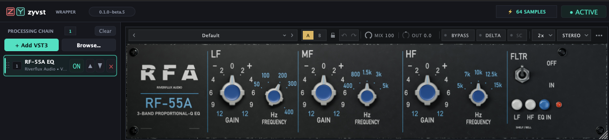

  

# zyvst

Bring your VST3 collection into your Audio Unit workflow. Build a stereo effects chain, play a favorite synth, or use a VST3 to generate and process MIDI, all from the plug-in slot where you need it.

[Download zyvst v1.0.0 for macOS](https://github.com/zackyusof/zyvst/releases/tag/v1.0.0)

## Three Audio Units for your sessions

| Audio Unit | Where it fits | What you can do |
| --- | --- | --- |
| **zyvst_fx** | Audio effect slot | Chain VST3 audio effects in stereo and shape your sound in one window. |
| **zyvst inst** | Software instrument slot | Play VST3 synths and instruments from your MIDI tracks. |
| **zyvst_midi** | MIDI FX slot | Add VST3 MIDI generators and processors to your instrument workflow. |

## Find your plug-ins fast

**+ Add VST3** opens a two-column picker with the cursor ready to type. Browse vendors on the left and see their plug-ins on the right. Search across vendors by plug-in or vendor name, or clear the search to return to browsing. Use arrow keys and Return to work from the keyboard. The picker shows plug-ins suited to each Audio Unit using available VST3 metadata. **Browse…** opens a bundle directly.

## Make the chain your own

- **Work with familiar controls.** Open hosted plug-in editors directly in the zyvst window and adjust them alongside the chain.
- **Shape the order.** Drag plug-ins into place or nudge them up and down. Remove a slot or clear the chain when you want to start fresh.
- **Compare in a click.** Bypass an individual slot or the entire chain. See the reported latency in samples while your DAW handles delay compensation.
- **Pick up where you left off.** Your session recalls the chain and the settings of its hosted plug-ins.
- **Keep MIDI in step.** For plug-ins that accept MIDI clock, zyvst can send clock and transport messages based on DAW playback. MIDI output depends on the hosted plug-in.

## Get started

Choose the ZIP for your track, unzip it, and copy the Audio Unit into your macOS Components folder. Reopen your DAW and find zyvst under **ZYVS**. Requires macOS 13 or later and a compatible Audio Unit host. Universal downloads support Apple Silicon and Intel Macs.
